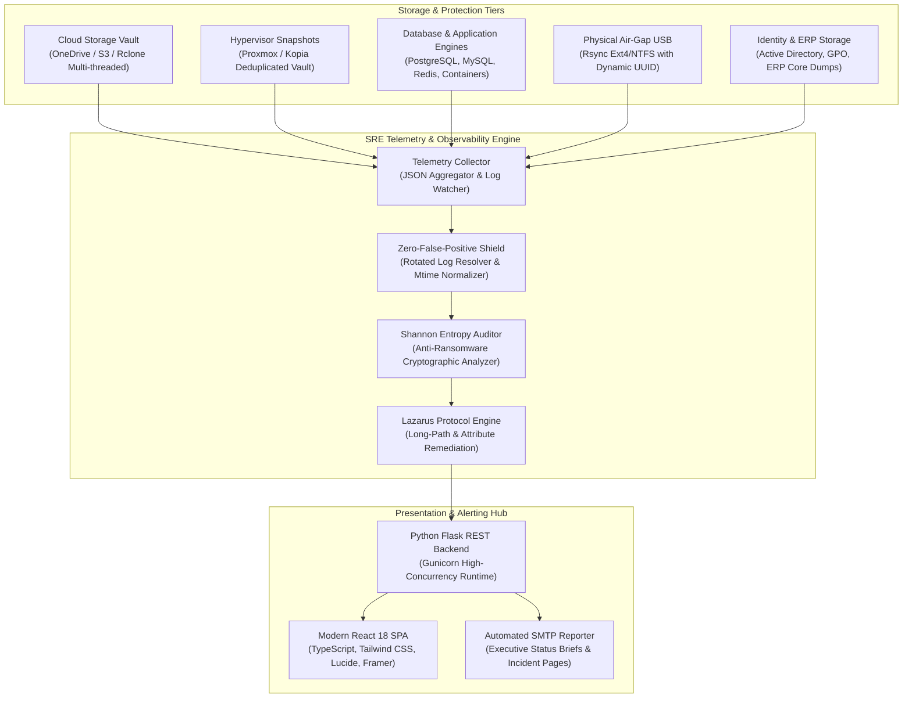

<div align="center">

# 🛡️ SRE Backup & Infrastructure Observability Platform

**Enterprise-grade Unified Telemetry, Disaster Recovery Observability, and Automated Integrity Auditing.**

[](https://github.com/ManoAlee/sre-backup-dashboard/actions)
[](https://github.com/ManoAlee/sre-backup-dashboard/releases)
[](https://python.org)
[](https://react.dev)
[](https://docker.com)
[](LICENSE)

<br/>

*Designed for mission-critical infrastructure, hybrid-cloud environments, and high-concurrency storage systems. Eliminates false positives, enforces real-time cryptographic auditability, and provides unified executive visibility across multi-cloud and on-premise disaster recovery assets.*

</div>

---

## 📌 Executive Overview

Modern disaster recovery architectures often suffer from fragmentation: backups run across heterogeneous environments (Microsoft 365 / Cloud Object Storage, hypervisor snapshots, database clusters, air-gapped physical drives, and distributed Linux servers), while observability relies on fragile grep scripts, unmonitored cron jobs, or silent failures.

The **SRE Backup & Infrastructure Observability Platform** unifies these disjointed layers into a single, high-fidelity operations control center. It replaces guesswork with **active evidence probing**, mathematical entropy verification, and resilient log parsing capable of distinguishing true anomalies from routine OS maintenance operations (such as log rotation).

---

## 🏗️ Architecture & Component Topology



---

## 🚀 Key Architectural Pillars

### 1. 🛡️ Zero-False-Positive Shield (SRE Audit Layer)
Traditional monitoring scripts fail when standard Linux maintenance utilities (such as `logrotate` with `copytruncate`) compress or truncate active `.log` files mid-cycle. The SRE Shield features:
- **Rotated Log Resolution (`resolve_rotated_log`)**: Transparently falls back to `.log.1` when files are truncated (< 100 bytes), ensuring zero false alarms.
- **Payload-Derived Chronology**: Extracts authoritative execution timestamps from internal cryptographic footers rather than volatile kernel file timestamps (`mtime`).
- **Structured JSON Verification**: Directly parses engine status schemas (`status_YYYYMMDD.json`) to validate container and database dump health with granular error codes.

### 2. 🧬 Shannon Entropy & Ransomware Inoculation
Backups that succeed with 0 exit codes can still transmit corrupted or ransomware-encrypted payloads. The platform calculates Shannon Entropy on backup artifacts ($H(X) = -\sum P(x) \log_2 P(x)$):
- Encrypted or compressed payloads naturally exhibit high entropy ($\approx 7.9$).
- Sudden abnormal entropy spikes in plain-text data or massive drops in compressed archives immediately flag uncommitted corruptions before snapshots propagate.

### 3. 🕊️ Lazarus Protocol (Deep Long-Path & ACL Healing)
Protects against silent NTFS/SMB/Linux synchronizer truncation where file paths exceed 260 characters (`MAX_PATH`) or contain malformed Unicode characters:
- Scans and indexes nested corporate shares.
- Automates non-destructive path aliasing to ensure 100% cloud sync fidelity.

### 4. 📊 Executive Confidence Score & Multi-Tier Health Metrics
Computes a dynamic confidence score ($0 - 100\%$) based on:
- Execution freshness against SLAs ($< 48\text{h}$ Cloud, $< 192\text{h}$ Air-Gap).
- Transferred bytes, throughput speedups, and volume capacity overheads.
- Active network socket handshake telemetry.

---

## ⚡ Quickstart

### Option A: Running via Docker Compose (Recommended)

1. **Clone the repository:**
   ```bash
   git clone https://github.com/ManoAlee/sre-backup-dashboard.git
   cd sre-backup-dashboard
   ```

2. **Configure your environment:**
   ```bash
   cp .env.example .env
   # Edit .env with your network configuration and credentials
   ```

3. **Spin up the stack:**
   ```bash
   docker compose up -d --build
   ```

4. **Access the dashboard:**
   Open [http://localhost:5000](http://localhost:5000) in your browser.

---

### Option B: Bare-Metal / Local Development

#### Prerequisites
- **Python:** 3.11+
- **Node.js:** 20+ and npm

#### 1. Setup Backend
```bash
python3 -m venv .venv
source .venv/bin/activate
pip install -r requirements.txt
```

#### 2. Compile Frontend Assets
```bash
cd frontend
npm install
npm run build
cd ..
```

#### 3. Run the Development Server
```bash
python3 app.py
```
*The Flask application will serve the compiled React SPA on port `5000`.*

---

## 📋 Production Deployment (Systemd Service)

To deploy as a managed Linux background service:

1. **Copy the service definition:**
   ```bash
   sudo cp sre-dashboard.service /etc/systemd/system/sre-backup-dashboard.service
   ```

2. **Reload systemd and start the daemon:**
   ```bash
   sudo systemctl daemon-reload
   sudo systemctl enable --now sre-backup-dashboard.service
   ```

3. **Check operational telemetry:**
   ```bash
   sudo systemctl status sre-backup-dashboard.service
   ```

---

## ⚙️ Environment Configuration Matrix

| Variable | Default Value | Description |
| :--- | :--- | :--- |
| `FLASK_ENV` | `production` | Execution environment mode (`production` / `development`) |
| `PORT` | `5000` | Network binding port for HTTP service |
| `SECRET_KEY` | *(Required)* | High-entropy string used for session signing |
| `STORAGE_NAS_HOST` | `192.168.10.200` | Primary NAS/SSHFS storage vault endpoint |
| `GATEWAY_ROUTER_IP` | `192.168.10.1` | Default gateway for network route liveness |
| `SMTP_SERVER` | `smtp.enterprise.local` | SMTP relay server for automated SRE dispatches |
| `SMTP_PORT` | `587` | SMTP port (TLS default: 587) |
| `BACKUP_MAX_AGE_HOURS_CLOUD`| `48` | Staleness SLA threshold for cloud sync routines |
| `BACKUP_MAX_AGE_HOURS_LOCAL`| `192` | Staleness SLA threshold for weekly air-gap media |

---

## 🛰️ API Reference & Telemetry Endpoints

| Method | Endpoint | Description |
| :--- | :--- | :--- |
| `GET` | `/api/health` | Service uptime, memory consumption, and load average |
| `GET` | `/api/telemetry/status` | Global confidence index, volume counts, and alert arrays |
| `GET` | `/api/backups/volumes` | Complete inventory of all monitored backup routines |
| `GET` | `/api/backups/logs/<job_id>` | Streamed, ANSI-sanitized audit log for a specific routine |
| `GET` | `/api/infrastructure/disks` | Storage utilization, capacity forecasts, and mount states |
| `GET` | `/api/applications/health` | Ingress gateway, upstream proxies, and database liveness |

---

## 🔒 Security & Compliance

- **Zero-PII Architecture**: All telemetry indices strip personal data and employ RFC-compliant synthetic representations for external demonstrations.
- **Principle of Least Privilege**: The dashboard operates entirely on read-only filesystem mounts (`:ro`) when querying log stores.
- **Air-Gap Integrity**: Physical drives are dynamically identified via filesystem UUIDs, mounted on-demand with sync flags, and cleanly unmounted after verification.

---

## 🤝 Contributing

We welcome contributions from the SRE, DevOps, and Platform Engineering communities! Please review [CONTRIBUTING.md](CONTRIBUTING.md) for code styling, pull request workflows, and development guidelines.

For responsible security disclosures, refer to [SECURITY.md](SECURITY.md).

---

## 📄 License

This platform is licensed under the **Apache License 2.0**. See the [LICENSE](LICENSE) file for complete terms and conditions.

---

<div align="center">
  <sub>Architected & Engineered by <strong><a href="https://github.com/ManoAlee">ManoAlee</a></strong> • SRE & Infrastructure Platform.</sub>
</div>
