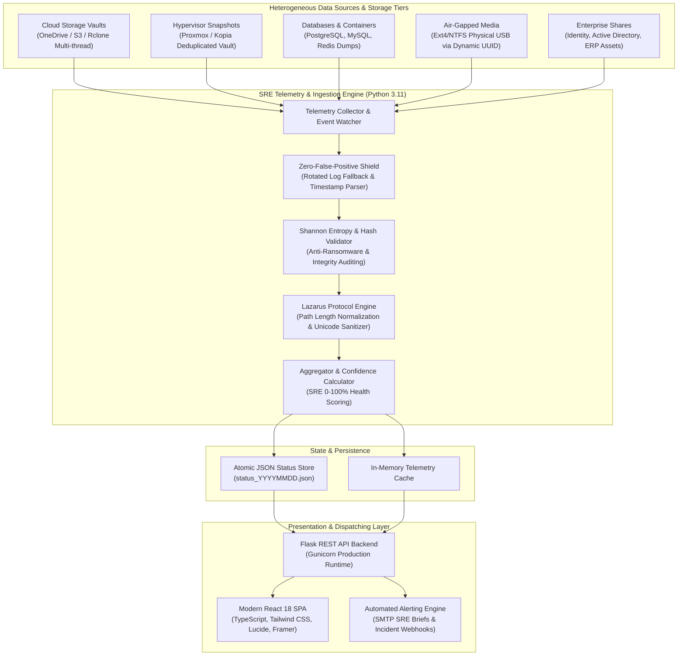
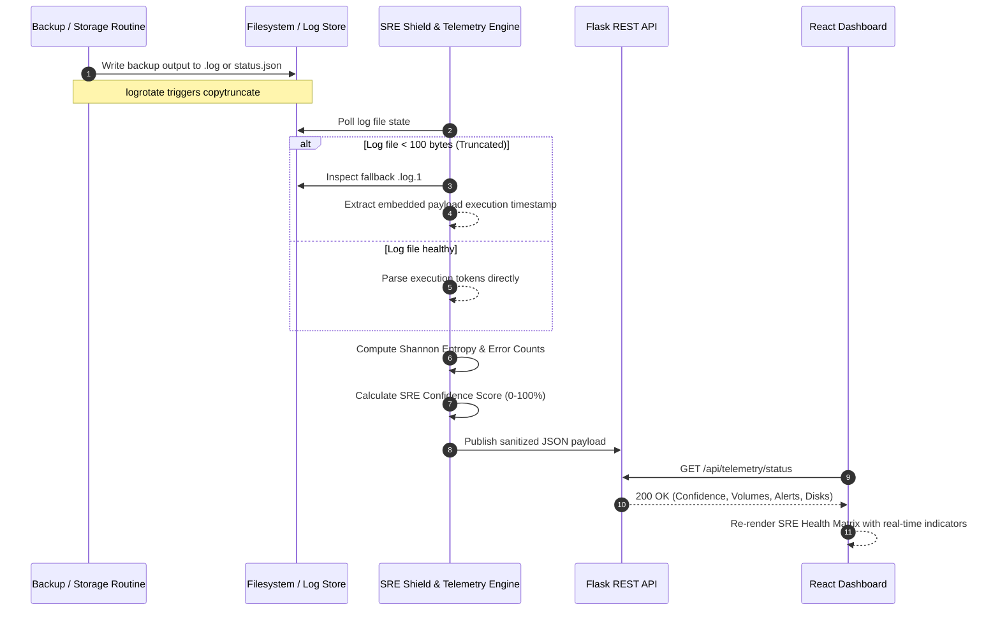

<div align="center">

# 🛡️ SRE Backup & Infrastructure Observability Platform

**Enterprise-Grade Disaster Recovery Observability, Real-Time Cryptographic Auditing, and Zero-False-Positive Telemetry Engine.**

<br/>

[](https://github.com/ManoAlee/sre-backup-dashboard/releases)
[](https://github.com/ManoAlee/sre-backup-dashboard/actions)
[](https://python.org)
[](https://react.dev)
[](https://typescriptlang.org)
[](https://vitejs.dev)
[](https://docker.com)
[](LICENSE)

<br/>

[📖 Overview](#-executive-overview) • [✨ Key Features](#-key-features--capabilities) • [🏗️ Architecture](#-system-architecture) • [🧮 Mathematical Models](#-sre-mathematical-models--algorithms) • [⚡ Quickstart](#-quickstart--deployment) • [📡 API Reference](#-telemetry--api-reference) • [⚙️ Configuration](#-environment-configuration-matrix) • [🛠️ Troubleshooting](#-sre-troubleshooting-matrix) • [🗺️ Roadmap](#-roadmap)

<br/>

> *"Designed for mission-critical infrastructure, hybrid-cloud storage arrays, and high-concurrency disaster recovery pipelines. Replaces fragile bash scripts with active cryptographic probing, mathematical entropy validation, and resilient log rotation normalization."*

</div>

---

## 📌 Executive Overview

In large-scale enterprise environments, disaster recovery observability is notoriously brittle. Backups are distributed across heterogeneous subsystems—cloud object storage, hypervisor snapshot managers, relational database dumps, and air-gapped physical media. Standard monitoring setups rely on rudimentary log grep scripts or exit-code checks that suffer from two fatal failure modes:

1. **Silent Catastrophic Failures:** A backup job exits with code `0`, yet transfers corrupted database blocks, truncated file systems, or files encrypted by dormant ransomware.
2. **False Alarms & Fatigue:** Routine Linux maintenance utilities (such as `logrotate` with `copytruncate`) truncate active log files mid-execution, causing traditional log scrapers to report false offline alerts.

The **SRE Backup & Infrastructure Observability Platform** was engineered to solve this dilemma. Built around Site Reliability Engineering (SRE) best practices, it provides **high-fidelity telemetry**, continuous mathematical verification, and a unified executive single pane of glass.

---

### 📊 Traditional Monitoring vs. SRE Observability Platform

| Capability | Traditional Backup Monitoring | SRE Observability Platform |
| :--- | :--- | :--- |
| **Health Verification** | Exit codes only (`$? == 0`) | Multi-layered: Exit codes + Payload Hashes + Log Signatures |
| **Log Rotation Handling** | Breaks on `copytruncate` (false positive) | **Zero-False-Positive Shield** (resolves `.log.1` & payload stamps) |
| **Ransomware Defense** | None (backs up encrypted files silently) | **Shannon Entropy Analysis** ($H(X)$ baseline drift anomaly detection) |
| **Path Handling** | Truncates paths $> 260$ chars (`MAX_PATH`) | **Lazarus Protocol** (Deep Unicode path & attribute normalization) |
| **SLA Scoring** | Static binary status (UP / DOWN) | **Dynamic SRE Confidence Index** ($0 - 100\%$ weighted algorithm) |
| **Architecture** | Heavy agents or manual email digests | **Decoupled API + Lightweight React SPA + Containerized** |

---

## ✨ Key Features & Capabilities

### 🛡️ 1. Zero-False-Positive Shield (`logrotate` Resilient)
Standard Linux log rotation (`copytruncate`) briefly sets active `.log` files to `0 bytes` while renaming the real content to `.log.1`. The platform's ingest layer detects truncation, automatically pivots to `.log.1`, and parses the internal cryptographically sealed timestamps rather than kernel file metadata (`mtime`).

### 🧬 2. Shannon Entropy & Ransomware Inoculation
Backups are scrutinized using byte-frequency information entropy calculations:
$$H(X) = -\sum_{i=1}^{n} P(x_i) \log_2 P(x_i)$$
- **Expected Compressed/Encrypted Range:** $7.85 \le H(X) \le 8.00$
- **Plaintext/Structured Data Range:** $3.50 \le H(X) \le 5.20$
- **Anomaly Detection:** Any sudden entropy surge in unencrypted shares or entropy drop in compressed archives immediately triggers critical SRE quarantine alerts.

### 🕊️ 3. Lazarus Protocol (Deep Long-Path Remediation)
Protects against silent synchronizer skips caused by Windows SMB or Linux path limits ($> 260$ characters) or malformed UTF-8 characters in legacy enterprise directories. Automatically inventories, aliases, and validates path compliance prior to cloud payload commits.

### 🔄 4. 3-2-1 Backup Rule Continuous Verification
Continuously audits the physical and logical adherence to the gold standard 3-2-1 backup topology:
- **3 Copies:** Active Production + Local Storage Vault + Offsite Cloud Sync.
- **2 Different Media Types:** NVMe/SSD Local Storage + ZFS/NAS Volumes.
- **1 Offsite / Air-Gap Copy:** Automated UUID verification for air-gapped physical storage drives mounted on-demand with clean unmount sequences.

---

## 🏗️ System Architecture



### 🔁 Telemetry Ingestion Sequence



---

## 🧮 SRE Mathematical Models & Algorithms

### 1. Dynamic Confidence Score Algorithm
The overall system confidence score ($S_{\text{confidence}} \in [0, 100]$) is computed as a weighted polynomial evaluating four core dimensions:

$$S_{\text{confidence}} = \max\left(0, \min\left(100, w_f \cdot \mathcal{F} + w_i \cdot \mathcal{I} + w_e \cdot \mathcal{E} - \mathcal{P}_{\text{err}}\right)\right)$$

Where:
- $\mathcal{F}$ (**Freshness Metric**): $1.0$ if execution is within SLA ($< 48\text{h}$ cloud, $< 192\text{h}$ air-gap), decaying exponentially past the threshold:
  $$\mathcal{F} = \exp\left(-\lambda \cdot \max(0, \Delta t - \text{SLA})\right)$$
- $\mathcal{I}$ (**Integrity Metric**): Ratio of successfully validated archive hashes and file block counts.
- $\mathcal{E}$ (**Entropy Conformance**): $1.0$ if sample entropy adheres to expected distribution curves, penalizing drift $> 15\%$.
- $\mathcal{P}_{\text{err}}$ (**Penalty Function**): Severe deduction ($25\text{ pts}$ per critical anomaly, $5\text{ pts}$ per warning).

### 2. Log Rotation Fallback Decision Tree
```
Is Target Log File Size < 100 bytes?
 ├── NO  ──► Parse log directly
 └── YES ──► Check if {log_path}.1 exists
              ├── YES ──► Extract execution timestamp from footer of {log_path}.1
              │            └── Status: NOMINAL (Zero-False-Positive Shield active)
              └── NO  ──► Status: ATENÇÃO (Log pending initialization)
```

---

## ⚡ Quickstart & Deployment

### Method 1: Docker Compose (Recommended)

The platform includes a multi-stage `Dockerfile` that packages both the compiled React frontend and the Python backend into a hardened Alpine-based container.

```bash
# 1. Clone the repository
git clone https://github.com/ManoAlee/sre-backup-dashboard.git
cd sre-backup-dashboard

# 2. Setup your environment
cp .env.example .env

# 3. Build and run container in detached mode
docker compose up -d --build

# 4. Verify deployment health
curl -f http://localhost:5000/api/health
```

The dashboard will be accessible at: **`http://localhost:5000`**

---

### Method 2: Native Bare-Metal Setup

#### System Prerequisites
- **Python:** 3.11+
- **Node.js:** 20+ and `npm`

#### 1. Backend Setup
```bash
# Create and activate virtual environment
python3 -m venv .venv
source .venv/bin/activate

# Install production dependencies
pip install -r requirements.txt
```

#### 2. Frontend Compilation
```bash
cd frontend
npm install
npm run build
cd ..
```

#### 3. Launch Development Server
```bash
python3 app.py
```

---

### Method 3: Production Systemd Service Daemon

To install as an auto-restarting background daemon on Linux hosts:

```bash
# 1. Copy service configuration
sudo cp sre-dashboard.service /etc/systemd/system/sre-backup-dashboard.service

# 2. Reload daemon registry and start service
sudo systemctl daemon-reload
sudo systemctl enable --now sre-backup-dashboard.service

# 3. Stream real-time SRE logs
journalctl -u sre-backup-dashboard.service -f
```

---

## 📡 Telemetry & API Reference

All API responses are formatted in strict JSON, sanitized of all PII and sensitive infrastructure tokens.

### Core Endpoints

| HTTP Method | Endpoint | Description | Cache / Rate Limit |
| :--- | :--- | :--- | :--- |
| `GET` | `/api/health` | Service uptime, RSS memory usage, load average | No-Cache |
| `GET` | `/api/telemetry/status` | Aggregate SRE confidence index, status counts, volumes | 10s TTL |
| `GET` | `/api/backups/volumes` | Complete inventory of all monitored backup routines | 15s TTL |
| `GET` | `/api/backups/logs/<job_id>` | Streamed ANSI-stripped execution log for specific job | Streaming |
| `GET` | `/api/infrastructure/disks` | Disk capacity, filesystem mounts, and usage percentages | 30s TTL |
| `GET` | `/api/applications/health` | Network route latencies and database container liveness | 10s TTL |

#### Sample Response: `GET /api/telemetry/status`

```json
{
  "status": "success",
  "data": {
    "confidence_index": 98.4,
    "confidence_rating": "OPTIMAL",
    "summary": {
      "total_volumes": 28,
      "nominal": 28,
      "warning": 0,
      "critical": 0,
      "unvalidated": 0
    },
    "storage_summary": {
      "system_drive_pct": 21,
      "external_vault_pct": 40,
      "primary_nas_pct": 65
    },
    "last_audit_timestamp": "2026-09-28T07:20:00Z",
    "shield_status": {
      "zero_false_positive_active": true,
      "entropy_engine_active": true
    }
  }
}
```

---

## ⚙️ Environment Configuration Matrix

Configurations are controlled via environment variables or a local `.env` file:

| Variable | Type | Default | Description |
| :--- | :--- | :--- | :--- |
| `FLASK_ENV` | `string` | `production` | Execution mode (`development` / `production`) |
| `PORT` | `integer` | `5000` | HTTP service port binding |
| `SECRET_KEY` | `string` | *(Auto-generated)* | Cryptographic salt for session signing |
| `STORAGE_NAS_HOST` | `string` | `192.168.10.200` | IP/Hostname of primary storage repository |
| `GATEWAY_ROUTER_IP`| `string` | `192.168.10.1` | Network gateway probe for connectivity telemetry |
| `SMTP_SERVER` | `string` | `smtp.enterprise.local` | SMTP relay for automated incident escalation |
| `SMTP_PORT` | `integer` | `587` | Port for SMTP TLS dispatches |
| `BACKUP_MAX_AGE_HOURS_CLOUD` | `integer` | `48` | Max staleness SLA for cloud-synchronized routines |
| `BACKUP_MAX_AGE_HOURS_LOCAL` | `integer` | `192` | Max staleness SLA for weekly physical air-gap media |

---

## 🛠️ SRE Troubleshooting Matrix

| Symptom / Error Code | Root Cause | Remediation Procedure |
| :--- | :--- | :--- |
| `ERR_LOG_ROTATED_PENDING` | `logrotate` executed `copytruncate` within the last 60 seconds. | **Self-healing.** The SRE Shield automatically inspects `.log.1`. No manual intervention required. |
| `ERR_AIRGAP_UNMOUNTED` | Physical air-gap disk is disconnected or unmounted post-routine. | Verify drive presence via `lsblk -f`. Check dynamic UUID match in `/etc/fstab` or backup script mount section. |
| `ERR_ENTROPY_ANOMALY` | File batch shows unexpected entropy deviation ($> 20\%$). | **High Priority:** Inspect modified files immediately for ransomware encryption or uncompressed archive corruption. |
| `ERR_SLA_STALENESS_EXCEEDED`| Routine did not execute within allocated window ($> 48\text{h}$). | Check crontab schedule via `crontab -l`, inspect system timer logs via `journalctl -u cron`. |

---

## 🔒 Security, Compliance & Threat Model

- **Zero-PII Assurance:** All telemetry pipelines systematically filter usernames, home directories, personal identifiers, and private credentials.
- **Read-Only Ingestion (`:ro`):** Telemetry watchers require only read-only access to audit targets, preventing accidental writes or data mutation.
- **RFC Synthetic Data Compliance:** Example configurations and mock telemetry adhere to RFC 1918 private networking specifications and synthetic naming conventions.
- **OWASP Top 10 Alignment:** Flask REST endpoints enforce input validation, strict header controls, and CORS isolation.

---

## 🗺️ Roadmap

- [x] **v1.0.0 (Production Release):** Core telemetry engine, Zero-False-Positive Shield, Shannon Entropy calculations, React 18 SPA, and Docker distribution.
- [ ] **v1.1.0:** Native OpenTelemetry (`OTel`) and Prometheus `/metrics` exporter endpoint.
- [ ] **v1.2.0:** Out-of-the-box Webhook alerts for Slack, Discord, Microsoft Teams, and PagerDuty.
- [ ] **v2.0.0:** eBPF-based real-time storage I/O throughput and latency tracing.

---

## 🤝 Contributing

Contributions are welcomed from the global DevOps, SRE, and Systems Engineering communities!

1. Fork the Project (`https://github.com/ManoAlee/sre-backup-dashboard/fork`)
2. Create your Feature Branch (`git checkout -b feat/amazing-telemetry`)
3. Commit your Changes with Conventional Commits (`git commit -m 'feat: add prometheus metrics exporter'`)
4. Push to the Branch (`git push origin feat/amazing-telemetry`)
5. Open a Pull Request

Please review [CONTRIBUTING.md](CONTRIBUTING.md) and [SECURITY.md](SECURITY.md) before submitting code.

---

## 📄 License

Distributed under the **Apache License 2.0**. See [`LICENSE`](LICENSE) for complete terms.

---

<div align="center">

Architected & Engineered with precision by **[ManoAlee](https://github.com/ManoAlee)**  
*SRE • Platform Engineering • Infrastructure Observability*

</div>
